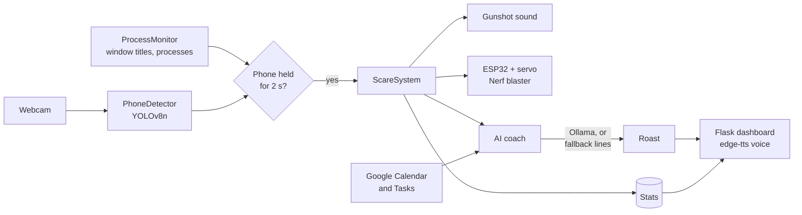
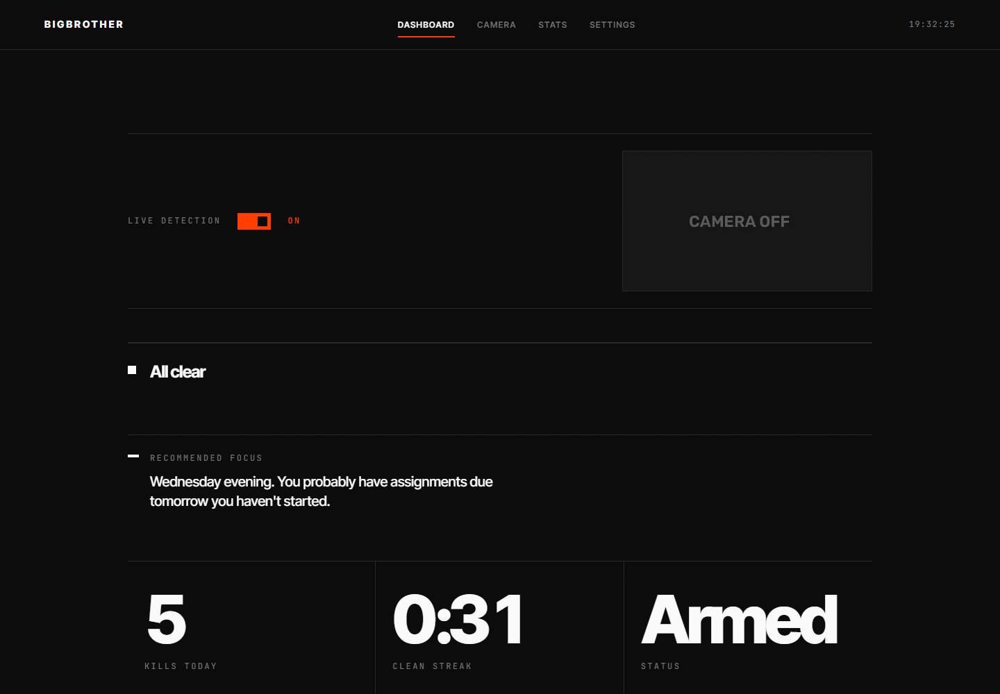
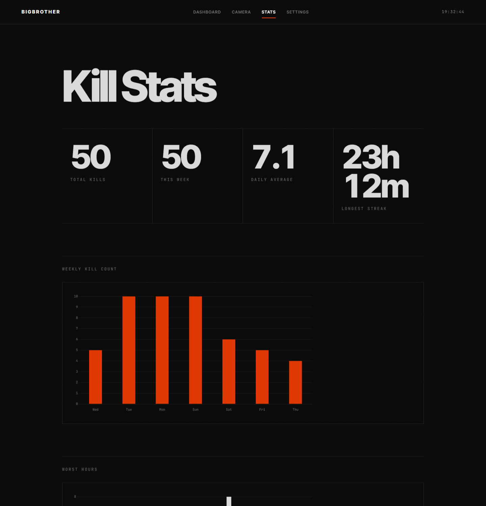
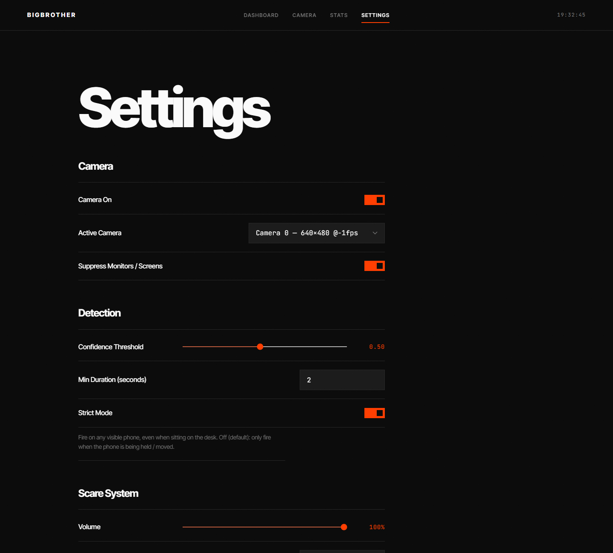

# BigBrother

**Always watching.** A desk-side productivity enforcer: a webcam and YOLOv8 notice when you pick up your phone, a Nerf blaster on an ESP32 fires at you, and an AI drill sergeant roasts you about whatever your Google Calendar says you should be doing instead.

It started as a prank project and grew into a full system: real-time computer vision, a local LLM, a Flask dashboard and custom hardware, all running on your own machine.


<sub>The detector on a public-domain test photo: phone found at 0.76 confidence and classified as held, which arms the scare system. Photo: [Wikimedia Commons, CC0](https://commons.wikimedia.org/wiki/File:Woman_using_an_iPhone.jpg).</sub>

## How it works



1. **Detect.** Each webcam frame goes through YOLOv8n (COCO class 67, *cell phone*). A phone only counts once it has been visible for `min_duration` seconds. Strict mode, which is on by default, fires on any visible phone. With it off, the detector also tracks how the box moves and ignores a phone lying still on the desk.
2. **Scare.** A random gunshot sound plays, the ESP32 pulls the blaster's trigger, and a cooldown starts. If the phone is still up after `escalation_delay` seconds, a looping alarm starts and a new roast follows.
3. **Roast.** The coach sends a local Ollama model the time, your current and next calendar events and how many times you've been caught today. The roast it gets back is 1–3 sentences, and it gets more fed up with each catch. If Ollama isn't running, the coach uses hand-written lines from [`config/roasts.yaml`](config/roasts.yaml). The dashboard reads each roast aloud, rotating between several edge-tts neural voices.
4. **Track.** Every catch is logged: counts per day, worst hours, longest clean streak and the full roast history.

Phones aren't the only distraction it catches. On Windows it also watches the active window and running processes for Instagram, TikTok, YouTube, Netflix, Discord, Steam and similar.

## Screenshots

| Dashboard | Stats |
|---|---|
|  |  |

| Settings |
|---|
|  |

The screenshots use sample data from `scripts/seed_demo_data.py`.

## Quick start

Requires Python 3.10+ and a webcam.

```bash
git clone https://github.com/cmigle/BigBrother.git
cd BigBrother
python -m venv .venv
.venv\Scripts\activate          # Windows
# source .venv/bin/activate     # macOS / Linux
pip install -r requirements.txt
python main.py
```

The dashboard opens at <http://localhost:5000>. On Windows you can also double-click `start.bat`. The YOLOv8n weights (6 MB) download automatically on first run.

Want to see the dashboard with data before using it for a week?

```bash
python scripts/seed_demo_data.py    # writes sample stats to data/
```

Useful flags: `--list-cameras`, `--select-camera`, `--no-browser`, `--config <path>`.

## Optional extras

Everything below is optional. Without it, the app still detects phones, keeps stats and roasts you with the fallback lines.

| Extra | Setup |
|---|---|
| **AI roasts** | Install [Ollama](https://ollama.com) and run `ollama pull llama3` |
| **Google Calendar and Tasks** | Create an OAuth *Desktop app* client in Google Cloud Console with the Calendar and Tasks APIs enabled, and save it as `config/credentials.json`. The first run opens a browser to sign in, and the token is stored in `config/token.json` |
| **Sounds** | Put `.wav` files in `sounds/`. `alarm*.wav` plays during escalation, `reload*.wav` when the cooldown ends, and any other file counts as a gunshot |
| **Nerf blaster** | Build the ESP32 trigger in [docs/hardware.md](docs/hardware.md) and set `hardware.wifi_enabled: true` |

## Configuration

Settings load in three layers, with later ones winning:

1. Defaults in `main.py`
2. [`config/settings.yaml`](config/settings.yaml), the shared defaults in the repo
3. `config/local.yaml`, your personal overrides (gitignored; copy [`config/local.yaml.example`](config/local.yaml.example))

| Setting | Default | What it does |
|---|---|---|
| `detection.confidence_threshold` | `0.5` | Minimum YOLO confidence for a phone |
| `detection.min_duration` | `2.0` | Seconds a phone must be held before the scare fires |
| `detection.strict_mode` | `true` | Fire on any visible phone, including one lying still |
| `detection.filter_screens` | `true` | Ignore phones that overlap a monitor or laptop, or are bigger than 20% of the frame |
| `scare.cooldown_seconds` | `15` | Minimum time between scares |
| `scare.escalation_delay` | `10` | Seconds before a still-raised phone triggers the alarm |
| `ai_coach.ollama_model` | `llama3` | Any model you've pulled into Ollama |
| `calendar.calendar_id` | `all` | `all`, `primary` or a specific calendar ID |
| `hardware.wifi_enabled` | `false` | Fire the ESP32 over Wi-Fi at `hardware.arduino_url` |
| `process_monitor.enabled` | `true` | Watch for distracting apps and sites (Windows) |
| `web.host` | `127.0.0.1` | Dashboard address. See [Privacy](#privacy) before changing it |

Most detection and scare settings can also be changed live from the Settings page.

## Dashboard and API

| Page | Contents |
|---|---|
| `/` | Live status, today's count, clean streak, latest roast, recommended focus, calendar and weekly plan |
| `/camera` | Live MJPEG feed with detection boxes |
| `/stats` | Weekly chart, worst hours, roast history |
| `/settings` | Camera choice, thresholds, volume, toggles |

| Endpoint | Method | Returns |
|---|---|---|
| `/api/status` | GET | Detection state, cooldown, today's count, latest roast |
| `/api/stats` | GET | All stats and roast history |
| `/api/calendar` | GET | Today's and tomorrow's events, and pending tasks |
| `/api/weekly-plan` | GET | Events and tasks grouped by day |
| `/api/calendar/complete` | POST | Marks an event done (`{"event_id": ...}`) |
| `/api/guess` | GET | What you should probably be doing right now |
| `/api/roast/latest`, `/api/roast/history` | GET | Roast text |
| `/api/roast/audio` | GET | The roast as MP3 (edge-tts) |
| `/api/camera/feed` | GET | MJPEG stream |
| `/api/cameras` | GET | Available camera indices |
| `/api/settings` | GET, POST | Read or update settings. Invalid values return 400 |

## Project structure

```
BigBrother/
├── main.py                  # entry point: config, module wiring, detection loop
├── core/
│   ├── phone_detector.py    # YOLOv8 detection, motion check, screen and size filters
│   ├── scare_system.py      # sounds, cooldown, escalation
│   ├── ai_coach.py          # Ollama prompts, fallback roasts, guesses, TTS
│   ├── calendar_sync.py     # Google Calendar and Tasks
│   ├── process_monitor.py   # distracting windows and processes (Windows)
│   ├── serial_gun.py        # ESP32 trigger over Wi-Fi or USB serial
│   └── stats_tracker.py     # counts, streaks, worst hours
├── web/
│   ├── server.py            # Flask app, JSON API, MJPEG stream, TTS endpoint
│   ├── templates/           # dashboard, camera, stats, settings
│   └── static/
├── firmware/trigger_servo/  # ESP32 Arduino sketch
├── config/                  # settings.yaml, roasts.yaml, local.yaml.example
├── scripts/
│   ├── seed_demo_data.py    # sample data for the dashboard
│   └── generate_audit.py    # probes a running server and writes an Excel audit report (needs openpyxl)
└── docs/                    # hardware guide, screenshots
```

## Privacy

- Everything runs locally. Frames are processed in memory and never saved, and roasts come from a model on your own machine.
- The dashboard binds to `127.0.0.1`. It has **no login**, so only set `web.host: "0.0.0.0"` on a network you trust: anyone who can reach the port can watch the camera.
- Google credentials (`config/credentials.json`, `config/token.json`) and your stats (`data/`) are gitignored.

## Known limitations

- The screen filter compares against YOLO's whole laptop box, keyboard included, so a phone held in front of a laptop that's visible in the frame gets suppressed. With the webcam built into the laptop this doesn't come up. Otherwise, turn off *Suppress Monitors / Screens*.
- Window-title and process monitoring only works on Windows. On macOS and Linux the rest of the app runs normally.
- The web server is Flask's development server, which is fine for a single local user.

## Team

Built by [Miglė Cirtautaitė](https://github.com/cmigle) and [Ignas Mikolaitis](https://github.com/ignuxas) at [Thunderclap Labs](https://thunderclaplabs.com), February–May 2026.
